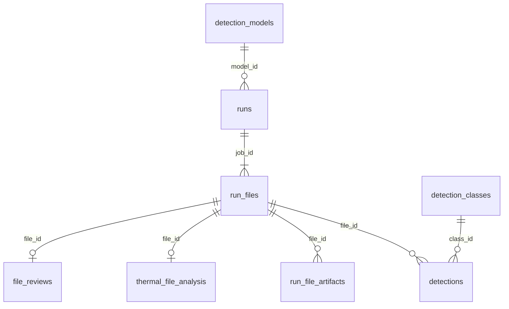

# Power Lines — Supabase database design

Additive layer on top of the existing FastAPI + disk artifact stack. **No application code changes are required** until you wire a repository; the API continues to use in-memory jobs and `/results/` files.

## Connection (local / Render secrets only)

| Variable | Description |
|----------|-------------|
| `SUPABASE_URL` | `https://vijzksrjfyajgggaeroj.supabase.co` |
| `SUPABASE_SERVICE_ROLE_KEY` | Server-only secret (Render env, never commit) |
| `SUPABASE_ANON_KEY` | Optional; browser only with RLS |

Copy from Supabase Dashboard → Project Settings → API. **Rotate keys** if they were pasted in chat.

## Entity map (app → tables)

| App concept | Table / view |
|-------------|----------------|
| `jobs`, `video_jobs`, `thermal_jobs` | `runs` |
| Per-file row in job | `run_files` |
| YOLO boxes (image + video frames) | `detections` (`frame_index` NULL = image) |
| `/results/...` URLs | `run_file_artifacts` |
| Thermal JSON | `thermal_file_analysis` |
| `AVAILABLE_MODELS` | `detection_models` |
| Sidebar component/defect/hidden | `detection_classes` + `is_component` on `detections` |
| Runs review localStorage | `file_reviews` |
| `GET /api/runs` | `v_runs_list` or `filter_runs()` |
| `GET /api/summary` | `v_dashboard_summary` + time filter on `runs` |

## ER diagram



## Filter coverage

| UI / API filter | SQL |
|-----------------|-----|
| Runs search (`run_id`, filename) | `filter_runs(p_search)` + `pg_trgm` on `run_files.filename` |
| Runs type `image` \| `video` \| `thermal` | `runs.run_type` + `thermal_analysis_job` → view `type` |
| Runs status | `runs.status` enum; RPC maps `complete` ↔ `completed` |
| Runs date range | `runs.created_at` + `filter_runs(p_date_from, p_date_to)` |
| Dashboard `today` / `7d` / `30d` / `custom` | `runs_in_time_range(p_range, p_from, p_to)` |
| Class name / ID | `detections.class_name`, `class_id`, `class_key` |
| Hidden classes (`simple_corrosion`) | `detection_classes.bucket = hidden` or `filter_detections_for_file(p_hidden_class_keys)` |
| Component vs defect sidebar | `detection_classes.bucket`, `detections.is_component`, `detection_sidebar_counts()` |
| Confidence threshold | `detections.confidence >= ?` |
| Video frame strip | `detections.frame_index` + index `(file_id, frame_index)` |
| GPS map | `runs.map_lat/lng`, `run_files.gps_lat/lng` |
| Batch URL `?batch=` | `runs.job_id` PK lookup |
| Model switch | `detection_models.is_active` (unique partial index) |

## Performance notes

- **Denormalized rollups** on `runs` and `run_files` (`findings_count`, `defect_type_count`, confidence aggregates) maintained by triggers on `detections`.
- **List endpoints** should query `v_runs_list` / rollups, not `SELECT * FROM detections`.
- **Video detail** loads boxes via `filter_detections_for_file(file_id)` (indexed by `file_id`).
- **Bulk insert** detections in batches (e.g. 500 rows) inside a transaction; one trigger refresh per file at end if needed.

## Apply migration

```bash
# Supabase CLI (recommended)
supabase link --project-ref vijzksrjfyajgggaeroj
supabase db push
```

Or run `supabase/migrations/001_powerlines_schema.sql` in SQL Editor.

## Next step (when you allow code changes)

1. Add `backend/supabase_client.py` using `SUPABASE_SERVICE_ROLE_KEY`.
2. On job create/update/complete, upsert `runs` / `run_files` / `detections` (mirror current JSON shapes).
3. Optionally replace `GET /api/runs` implementation with `filter_runs()` while keeping response JSON identical.

Artifacts can stay on disk; only store `relative_url` in `run_file_artifacts`.
